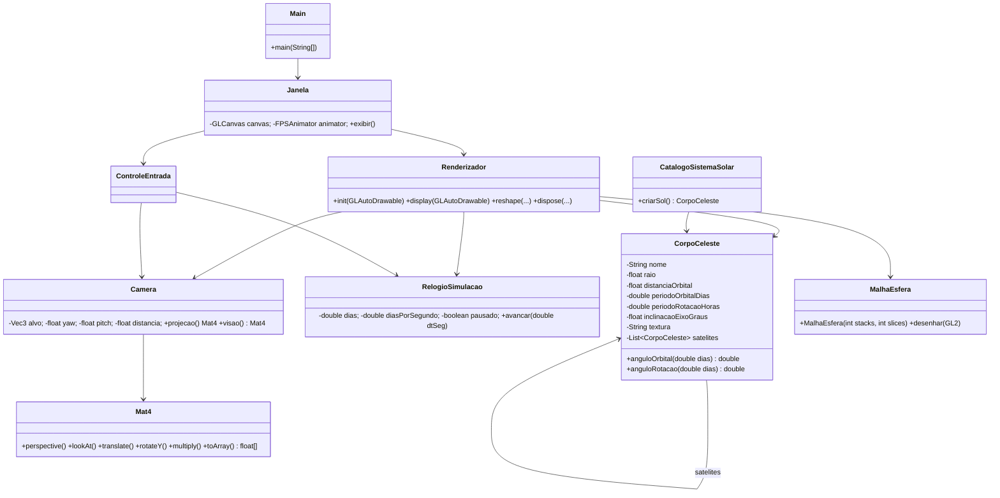
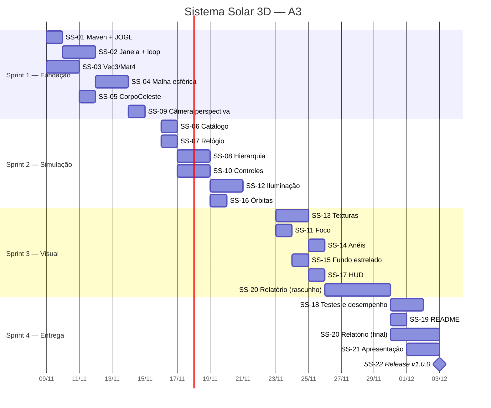

# Escopo Técnico — Sistema Solar 3D em OpenGL

> Documento de escopo, backlog e planejamento de sprints do Trabalho A3 de Computação Gráfica e Realidade Virtual (UNIFACS).
> Baseado no [README](../README.md) do projeto. Entrega final: **03/12/2026**.

---

## 1. Visão geral

Aplicação desktop em **Java** com **OpenGL (JOGL)** que renderiza o Sistema Solar em 3D: Sol, 8 planetas e a Lua, com órbitas (translação) e rotação em torno do próprio eixo, iluminação a partir do Sol, texturas e uma câmera navegável (rotação, pan e zoom).

### 1.1 Objetivos técnicos (o que precisa ser demonstrado)

| Conceito do README | Onde aparece na implementação |
|---|---|
| Matrizes de translação e rotação | Composição hierárquica `Sol → Planeta → Lua` no `Renderizador` e cálculos na classe `Mat4` |
| Projeção perspectiva | Matriz de projeção montada pela `Camera` (`perspective`) e carregada com `glLoadMatrixf` |
| Primitivas geométricas / malha esférica | `MalhaEsfera` gera vértices, normais, UVs e índices de uma UV-sphere |
| Loop de renderização, iluminação e texturas | `Renderizador.display()` + `GL_LIGHT0` no Sol + `TextureIO` |
| Navegação 3D (Pan, Zoom, Rotação) | `Camera` orbital + `ControleEntrada` (mouse/teclado) |

### 1.2 Fora do escopo

- Escala física real de distâncias e raios (inviável visualmente; usaremos escala artística — ver §4).
- Física gravitacional (N-corpos). Órbitas são paramétricas.
- Asteroides, cometas e luas além da Lua da Terra (podem entrar como *stretch goal*).
- Suporte a VR/headset.

---

## 2. Stack e decisões técnicas

| Item | Decisão | Justificativa |
|---|---|---|
| Linguagem | **Java 17 (LTS)** | Exigência do trabalho; LTS estável com JOGL |
| Binding OpenGL | **JOGL 2.5.0** (`jogl-all` + `gluegen-rt`, via repositório Maven da JogAmp) | Citado no README; `GLJPanel`/`GLCanvas` integram com Swing |
| Perfil OpenGL | **GL2** (pipeline fixo + VBO) | Permite usar `glPushMatrix/glPopMatrix` para mostrar a hierarquia de transformações de forma didática, sem custo de escrever shaders |
| Build | **Maven** (`pom.xml`) | Resolve dependências e nativos do JOGL; abre em IntelliJ e Eclipse |
| Testes | **JUnit 5** | Testar a matemática (matrizes, malha, posição orbital) sem contexto gráfico |
| Animação | `FPSAnimator` a 60 FPS + *delta time* com `System.nanoTime()` | Velocidade da simulação independente da taxa de quadros |
| Texturas | Mapas equiretangulares 2K (Solar System Scope, CC BY 4.0) | Licença livre; exige crédito no README/relatório |

> **Fallback:** se os nativos do JOGL 2.5 derem problema em alguma máquina, usar `org.jogamp.jogl:jogl-all-main:2.3.2` do Maven Central (o código GL2 é o mesmo).

### 2.1 Estrutura de pacotes

```
src/
├── main/java/br/unifacs/a3/sistemasolar/
│   ├── Main.java                  # ponto de entrada
│   ├── app/
│   │   └── Janela.java            # JFrame + GLCanvas + FPSAnimator
│   ├── render/
│   │   ├── Renderizador.java      # GLEventListener (init/display/reshape/dispose)
│   │   ├── MalhaEsfera.java       # geração da UV-sphere + upload em VBO
│   │   ├── GerenciadorTexturas.java
│   │   ├── Orbitas.java           # linhas das órbitas (GL_LINE_LOOP)
│   │   ├── Aneis.java             # anel de Saturno (disco com textura alfa)
│   │   ├── FundoEstrelado.java    # skysphere / estrelas
│   │   └── Hud.java               # textos na tela (TextRenderer)
│   ├── modelo/
│   │   ├── CorpoCeleste.java
│   │   ├── CatalogoSistemaSolar.java   # dados dos planetas
│   │   └── RelogioSimulacao.java
│   ├── camera/
│   │   ├── Camera.java
│   │   └── ControleEntrada.java   # MouseListener/KeyListener
│   └── math/
│       ├── Vec3.java
│       └── Mat4.java
├── main/resources/texturas/       # sol.jpg, terra.jpg, ..., saturno_anel.png, estrelas.jpg
└── test/java/br/unifacs/a3/sistemasolar/
    ├── math/Mat4Test.java
    ├── render/MalhaEsferaTest.java
    └── modelo/CorpoCelesteTest.java
```

### 2.2 Diagrama de classes



---

## 3. Modelos matemáticos (detalhamento)

### 3.1 Hierarquia de transformações

Para cada corpo, a matriz de modelo é composta (da esquerda para a direita, como no `glMultMatrix`):

```
M_planeta = M_pai · R_y(θ_orbita) · T(d, 0, 0) · [ R_z(inclinação) · R_y(θ_rotacao) · S(r) ]
                                               └─────── só para desenhar o próprio corpo ───────┘
```

- `R_y(θ_orbita) · T(d,0,0)` posiciona o corpo na órbita — **é herdado pelos satélites** (a Lua orbita a Terra).
- `R_z(inclinação) · R_y(θ_rotacao) · S(r)` é aplicado **dentro de um `glPushMatrix/glPopMatrix`**, para que a rotação, a inclinação e a escala do planeta **não** sejam herdadas pela Lua.

Em pseudocódigo (GL2):

```java
void desenharCorpo(GL2 gl, CorpoCeleste c, double dias) {
    gl.glPushMatrix();
    gl.glRotated(c.anguloOrbital(dias), 0, 1, 0);   // translação orbital
    gl.glTranslatef(c.getDistanciaOrbital(), 0, 0);

    gl.glPushMatrix();                                // transformações locais
    gl.glRotatef(c.getInclinacaoEixoGraus(), 0, 0, 1);
    gl.glRotated(c.anguloRotacao(dias), 0, 1, 0);
    gl.glScalef(c.getRaio(), c.getRaio(), c.getRaio());
    malhaEsfera.desenhar(gl, texturas.get(c));
    gl.glPopMatrix();

    for (CorpoCeleste s : c.getSatelites()) desenharCorpo(gl, s, dias);
    gl.glPopMatrix();
}
```

### 3.2 Ângulos em função do tempo

O `RelogioSimulacao` mantém o tempo simulado em **dias**:

```
dias += dt_real_segundos · diasPorSegundo        (dias não avança se pausado)

θ_orbita(dias)  = 360° · (dias / periodoOrbitalDias)            mod 360
θ_rotacao(dias) = 360° · (dias · 24 / periodoRotacaoHoras)      mod 360
```

- Períodos negativos representam rotação **retrógrada** (Vênus e Urano).
- Para evitar *strobing* (rotação rápida demais em relação ao FPS), a rotação usa um fator visual próprio (`fatorRotacaoVisual`, padrão `0.05`), multiplicado em `θ_rotacao`.

### 3.3 Projeção perspectiva

`Mat4.perspective(fovY, aspect, near, far)` com `f = 1 / tan(fovY / 2)`:

```
| f/aspect  0        0                        0                      |
| 0         f        0                        0                      |
| 0         0   (far+near)/(near-far)   (2·far·near)/(near-far)      |
| 0         0       -1                        0                      |
```

Valores: `fovY = 45°`, `near = 0.1`, `far = 1000`. O `aspect` é atualizado em `reshape()`.
A matriz é carregada em **column-major** com `gl.glMatrixMode(GL_PROJECTION); gl.glLoadMatrixf(m.toArray(), 0)`.

### 3.4 Matriz de visualização (câmera orbital)

A câmera orbita um ponto `alvo` usando coordenadas esféricas:

```
eye = alvo + distancia · ( cos(pitch)·sin(yaw),  sin(pitch),  cos(pitch)·cos(yaw) )
```

`Mat4.lookAt(eye, alvo, up)`:

```
f = normalize(alvo - eye);  s = normalize(f × up);  u = s × f

| s.x   s.y   s.z   -s·eye |
| u.x   u.y   u.z   -u·eye |
| -f.x  -f.y  -f.z   f·eye |
| 0     0     0      1     |
```

Restrições: `pitch ∈ [-89°, 89°]` (evita *gimbal flip*), `distancia ∈ [3, 400]`.

### 3.5 Malha esférica (UV-sphere)

Para `i ∈ [0, stacks]` e `j ∈ [0, slices]`:

```
φ = π · i / stacks          (latitude, 0..π)
θ = 2π · j / slices         (longitude, 0..2π)

posição = ( sin φ · cos θ,  cos φ,  sin φ · sin θ )     (raio unitário; escala vem de S(r))
normal  = posição
uv      = ( j / slices,  i / stacks )
```

- Total de vértices: `(stacks + 1) · (slices + 1)`; total de índices: `6 · stacks · slices`.
- A malha é gerada **uma única vez** (`stacks = 48`, `slices = 64`), enviada para VBO e reutilizada para todos os corpos.

---

## 4. Dados dos corpos celestes

Valores reais (fonte: NASA Planetary Fact Sheet) e valores de cena (escala artística):

| Corpo | Raio real (km) | Raio cena | Dist. real (UA) | Dist. cena | Per. orbital (dias) | Per. rotação (h) | Inclinação eixo (°) |
|---|---:|---:|---:|---:|---:|---:|---:|
| Sol | 696.340 | 5,0 | — | 0 | — | 609,1 | 7,25 |
| Mercúrio | 2.440 | 0,40 | 0,39 | 9 | 87,97 | 1.407,6 | 0,03 |
| Vênus | 6.052 | 0,90 | 0,72 | 13 | 224,70 | −5.832,5 | 177,4 |
| Terra | 6.371 | 1,00 | 1,00 | 18 | 365,26 | 23,93 | 23,44 |
| ↳ Lua | 1.737 | 0,27 | 384.400 km | 2,0 (da Terra) | 27,32 | 655,7 | 6,68 |
| Marte | 3.390 | 0,60 | 1,52 | 23 | 686,98 | 24,62 | 25,19 |
| Júpiter | 69.911 | 2,80 | 5,20 | 34 | 4.332,59 | 9,93 | 3,13 |
| Saturno | 58.232 | 2,40 | 9,58 | 46 | 10.759,22 | 10,66 | 26,73 |
| Urano | 25.362 | 1,70 | 19,20 | 57 | 30.688,50 | −17,24 | 97,77 |
| Netuno | 24.622 | 1,60 | 30,05 | 67 | 60.182,00 | 16,11 | 28,32 |

Os **períodos e inclinações são reais**; apenas raio e distância são comprimidos. Esses dados ficam centralizados em `CatalogoSistemaSolar`.

---

## 5. Controles da aplicação

| Entrada | Ação |
|---|---|
| Arrastar com botão esquerdo | Rotacionar câmera (yaw/pitch) |
| Arrastar com botão direito | Pan (move o `alvo` no plano da tela) |
| Roda do mouse | Zoom (`distancia *= 1.1^passos`) |
| `0` – `8` | Focar no Sol (0) ou no planeta n (câmera segue o corpo) |
| `Espaço` | Pausar / retomar a simulação |
| `+` / `-` | Dobrar / reduzir à metade a velocidade (`diasPorSegundo`) |
| `O` | Mostrar / esconder órbitas |
| `L` | Ligar / desligar iluminação |
| `R` | Resetar câmera e tempo |
| `H` | Mostrar / esconder ajuda de controles no HUD |
| `Esc` | Sair |

---

## 6. Backlog de implementação (tickets)

**Convenções**
- ID: `SS-XX`. Branch: `feature/SS-XX-descricao-curta`. Commits no padrão *Conventional Commits* (`feat(render): ... [SS-04]`).
- Estimativa em *story points* (1 = poucas horas, 2 = meio dia, 3 = um dia, 5 = 2–3 dias).
- Prioridade: **P0** obrigatório para a avaliação · **P1** importante · **P2** desejável (*stretch*).
- Responsável sugerido: **H** = Hanspeter · **E** = Edioelson (ajustar na planning).

### Épicos

| Épico | Descrição | Tickets |
|---|---|---|
| E1 — Fundação | Projeto, build, janela e loop OpenGL | SS-01, SS-02 |
| E2 — Matemática | Vetores, matrizes e malha esférica | SS-03, SS-04 |
| E3 — Simulação | Modelo dos corpos, tempo e hierarquia | SS-05, SS-06, SS-07, SS-08 |
| E4 — Câmera e interação | Projeção, visão e controles | SS-09, SS-10, SS-11 |
| E5 — Visual | Iluminação, texturas, anéis, fundo, órbitas, HUD | SS-12 a SS-17 |
| E6 — Qualidade e entrega | Testes, desempenho, docs, relatório, apresentação | SS-18 a SS-22 |
| Backlog *stretch* | Extras se sobrar tempo | SS-23 a SS-25 |

---

### E1 — Fundação

#### SS-01 · Configurar projeto Maven com JOGL — P0 · 2 pts · H
**Descrição:** Criar `pom.xml` (Java 17), dependências `jogl-all`, `gluegen-rt` (com nativos) e `junit-jupiter`; estrutura de pacotes do §2.1.
**Critérios de aceite:**
- [ ] `mvn clean package` compila sem erros em Windows nas duas máquinas do grupo.
- [ ] `mvn test` roda (mesmo com um teste vazio).
- [ ] Projeto abre no IntelliJ e no Eclipse sem configuração manual de classpath.
- [ ] `.gitignore` inclui `target/`, `.idea/`, `*.iml`, `.classpath`, `.project`.

**Notas técnicas:** adicionar o repositório `https://jogamp.org/deployment/maven/`. Configurar `exec-maven-plugin` para `mvn exec:java` rodar a `Main`.

#### SS-02 · Janela, contexto OpenGL e loop de renderização — P0 · 3 pts · H
**Dependências:** SS-01
**Descrição:** `Main` cria a `Janela` (JFrame 1280×720 com `GLCanvas`, perfil `GL2`), registra o `Renderizador` (`GLEventListener`) e inicia o `FPSAnimator(60)`.
**Critérios de aceite:**
- [ ] Janela abre com fundo preto e título "Sistema Solar 3D — A3".
- [ ] `init()` habilita `GL_DEPTH_TEST`, `GL_CULL_FACE` e define `glClearColor(0,0,0,1)`.
- [ ] `reshape()` atualiza viewport e *aspect ratio* sem distorção ao redimensionar.
- [ ] Fechar a janela para o animator e libera recursos em `dispose()` (sem processo zumbi).
- [ ] `display()` calcula `dt` em segundos via `System.nanoTime()`.

---

### E2 — Matemática

#### SS-03 · Biblioteca `Vec3` e `Mat4` — P0 · 3 pts · E
**Descrição:** Implementar operações usadas no projeto, armazenamento em `float[16]` **column-major**.
**Critérios de aceite:**
- [ ] `Vec3`: soma, subtração, escala, `dot`, `cross`, `length`, `normalize`.
- [ ] `Mat4`: `identity`, `multiply`, `translate`, `rotateX/Y/Z` (graus), `scale`, `perspective` (§3.3), `lookAt` (§3.4), `toArray()`.
- [ ] `Mat4Test` cobre: identidade, `translate·ponto`, rotação de 90° em Y leva (1,0,0) em (0,0,−1), `perspective` igual à referência de `gluPerspective` com tolerância 1e-5, `lookAt` com eye em (0,0,5) olhando a origem.

**Notas técnicas:** essas classes são a principal evidência dos "modelos matemáticos" no relatório — documentar cada fórmula no Javadoc.

#### SS-04 · Geração da malha esférica (UV-sphere) em VBO — P0 · 3 pts · E
**Dependências:** SS-02
**Descrição:** `MalhaEsfera(stacks, slices)` gera posições, normais, UVs e índices (§3.5) e os envia para VBO/IBO; `desenhar(gl)` usa `glDrawElements(GL_TRIANGLES, ...)`.
**Critérios de aceite:**
- [ ] Geração separada do upload (método puro `gerar()` testável sem GL).
- [ ] `MalhaEsferaTest`: nº de vértices = `(stacks+1)(slices+1)`, nº de índices = `6·stacks·slices`, todas as normais com comprimento 1 ± 1e-6, UVs em [0,1].
- [ ] Esfera aparece sólida e sem buracos na tela (teste visual em wireframe com `glPolygonMode(GL_LINE)`).
- [ ] Ordem dos triângulos anti-horária vista de fora (compatível com `GL_CULL_FACE`).

---

### E3 — Simulação

#### SS-05 · Classe `CorpoCeleste` — P0 · 2 pts · E
**Dependências:** SS-03
**Descrição:** Modelo com nome, raio, distância orbital, períodos orbital e de rotação, inclinação do eixo, caminho da textura, cor fallback e lista de satélites.
**Critérios de aceite:**
- [ ] `anguloOrbital(dias)` e `anguloRotacao(dias)` conforme §3.2, sempre em [0, 360).
- [ ] Período orbital `0`/ausente (Sol) resulta em ângulo orbital 0.
- [ ] Períodos negativos invertem o sentido.
- [ ] `CorpoCelesteTest`: Terra em `dias = 365.26/4` tem ângulo orbital 90°; Vênus gira em sentido negativo.

#### SS-06 · Catálogo do Sistema Solar — P0 · 1 pt · E
**Dependências:** SS-05
**Descrição:** `CatalogoSistemaSolar.criarSol()` monta a árvore Sol → 8 planetas → Lua com os valores do §4.
**Critérios de aceite:**
- [ ] Todos os valores da tabela do §4 presentes e com comentário de fonte.
- [ ] Lua cadastrada como satélite da Terra.

#### SS-07 · Relógio de simulação — P0 · 1 pt · H
**Dependências:** SS-02
**Descrição:** `RelogioSimulacao` com `avancar(dt)`, `pausar/retomar`, `acelerar/desacelerar` (×2, ÷2, limites 0,125 a 512 dias/s) e `resetar`.
**Critérios de aceite:**
- [ ] Padrão: 10 dias simulados por segundo real.
- [ ] Pausado → `dias` não muda; animação da câmera continua funcionando.
- [ ] Velocidade independe do FPS (teste: 30 FPS e 60 FPS chegam ao mesmo `dias` em 1 s).

#### SS-08 · Renderização hierárquica Sol → Planetas → Lua — P0 · 3 pts · H
**Dependências:** SS-04, SS-06, SS-07
**Descrição:** Método recursivo `desenharCorpo` (§3.1) no `Renderizador`, usando a pilha de matrizes do GL2.
**Critérios de aceite:**
- [ ] Os 8 planetas orbitam o Sol no sentido anti-horário visto de cima.
- [ ] A Lua orbita a Terra e acompanha a translação dela, **sem** herdar a rotação/inclinação/escala da Terra.
- [ ] Inclinação do eixo visível (Urano "deitado").
- [ ] Pilha de matrizes balanceada (nenhum `GL_STACK_OVERFLOW/UNDERFLOW` em `glGetError`).

---

### E4 — Câmera e interação

#### SS-09 · Câmera com projeção perspectiva e `lookAt` — P0 · 2 pts · H
**Dependências:** SS-03, SS-02
**Descrição:** `Camera` produz matriz de projeção (§3.3) e de visão (§3.4) a partir de `alvo`, `yaw`, `pitch` e `distancia`; o `Renderizador` carrega as duas no início de cada `display()`.
**Critérios de aceite:**
- [ ] Posição inicial mostra o sistema inteiro em perspectiva oblíqua (pitch ≈ 25°, distância ≈ 110).
- [ ] Nada é cortado indevidamente pelos planos `near`/`far`.
- [ ] Redimensionar a janela não distorce as esferas.

#### SS-10 · Controles de mouse e teclado — P0 · 3 pts · E
**Dependências:** SS-09, SS-07
**Descrição:** `ControleEntrada` implementa `MouseListener`, `MouseMotionListener`, `MouseWheelListener` e `KeyListener` com o mapeamento do §5.
**Critérios de aceite:**
- [ ] Rotação, pan e zoom suaves e com limites (§3.4).
- [ ] Pan se move no plano da tela (usa os vetores `s` e `u` da câmera), proporcional à distância.
- [ ] Teclas de tempo (`Espaço`, `+`, `-`, `R`) funcionando.
- [ ] Eventos de input são apenas registrados na thread do AWT e aplicados no `display()` (evita condição de corrida com a thread do animator).

#### SS-11 · Foco em corpo celeste — P1 · 2 pts · E
**Dependências:** SS-08, SS-10
**Descrição:** Teclas `0`–`8` fazem a câmera seguir o corpo selecionado (o `alvo` passa a ser a posição mundial do corpo a cada quadro).
**Critérios de aceite:**
- [ ] Posição mundial calculada com `Mat4` (mesma composição do §3.1), não lida da GPU.
- [ ] Transição suave do alvo (interpolação linear ~0,5 s).
- [ ] Distância ajustada automaticamente para `raio · 8`.

---

### E5 — Visual

#### SS-12 · Iluminação com o Sol como fonte de luz — P0 · 3 pts · H
**Dependências:** SS-08
**Descrição:** `GL_LIGHT0` pontual na origem (`w = 1`), reposicionada após carregar a matriz de visão a cada quadro.
**Critérios de aceite:**
- [ ] Planetas exibem lado iluminado voltado ao Sol e lado noturno escuro (ambiente ≈ 0,05).
- [ ] Sol desenhado com `GL_EMISSION` (ou iluminação desligada) — não fica sombreado.
- [ ] `GL_NORMALIZE` ou `GL_RESCALE_NORMAL` habilitado (normais corretas após `glScalef`).
- [ ] Tecla `L` alterna iluminação.

#### SS-13 · Texturas dos corpos celestes — P0 · 3 pts · E
**Dependências:** SS-04, SS-08
**Descrição:** `GerenciadorTexturas` carrega as imagens de `resources/texturas` com `TextureIO`, com mipmaps e `GL_LINEAR_MIPMAP_LINEAR`; combinação `GL_MODULATE` com a iluminação.
**Critérios de aceite:**
- [ ] Todos os 10 corpos texturizados, sem costura visível na longitude 0°.
- [ ] Se uma textura faltar, o corpo usa a cor fallback e um aviso é logado (a aplicação não cai).
- [ ] Texturas carregadas uma vez no `init()` e liberadas no `dispose()`.
- [ ] Créditos da fonte das texturas no README.

**Notas técnicas:** imagens em 2048×1024 (JPG) para manter o repositório leve (< 20 MB no total).

#### SS-14 · Anéis de Saturno — P1 · 2 pts · H
**Dependências:** SS-13
**Descrição:** `Aneis` gera um disco (*triangle strip* entre raio interno 1,2·r e externo 2,3·r) com textura PNG com alfa, desenhado no referencial local de Saturno (herda a inclinação de 26,73°).
**Critérios de aceite:**
- [ ] Transparência com `GL_BLEND` (`SRC_ALPHA, ONE_MINUS_SRC_ALPHA`), desenhado após os corpos opacos.
- [ ] Visível dos dois lados (`GL_CULL_FACE` desabilitado só para o anel).

#### SS-15 · Fundo estrelado — P1 · 2 pts · E
**Dependências:** SS-04, SS-09
**Descrição:** Esfera grande (raio 900) com textura de Via Láctea vista por dentro, centrada na câmera, sem escrita no depth buffer.
**Critérios de aceite:**
- [ ] Fundo não se desloca com pan/zoom, apenas com rotação.
- [ ] Desenhado primeiro, com `glDepthMask(false)` e iluminação desligada.

#### SS-16 · Linhas das órbitas — P1 · 1 pt · E
**Dependências:** SS-08
**Descrição:** `Orbitas` desenha um `GL_LINE_LOOP` de 128 segmentos para cada corpo, no referencial do pai.
**Critérios de aceite:**
- [ ] Cor cinza translúcida, sem iluminação nem textura.
- [ ] Tecla `O` alterna a exibição.
- [ ] A órbita da Lua acompanha a Terra.

#### SS-17 · HUD com informações — P1 · 2 pts · H
**Dependências:** SS-07, SS-11
**Descrição:** `Hud` usa `TextRenderer` (JOGL awt util) para mostrar FPS, data simulada (dias/anos), velocidade da simulação, corpo em foco e legenda resumida dos controles.
**Critérios de aceite:**
- [ ] Texto legível sobre qualquer fundo (sombra ou fundo semitransparente).
- [ ] `H` mostra/esconde a ajuda de controles.

---

### E6 — Qualidade e entrega

#### SS-18 · Testes, desempenho e robustez — P0 · 2 pts · H + E
**Dependências:** SS-08 a SS-13
**Critérios de aceite:**
- [ ] `mvn test` verde; cobertura dos pacotes `math` e `modelo` ≥ 80%.
- [ ] ≥ 60 FPS estáveis em notebook com GPU integrada a 1280×720.
- [ ] Nenhum erro em `glGetError()` (checagem em modo debug com `DebugGL2`).
- [ ] Teste de 10 minutos rodando sem aumento de memória (sem vazamento de textura/VBO).

#### SS-19 · Atualizar README — P0 · 1 pt · E
**Critérios de aceite:**
- [ ] Versão do JDK definida (substituir "versão X" por Java 17).
- [ ] Comandos reais de build/execução (`mvn clean package`, `mvn exec:java`).
- [ ] URL correta do repositório, tabela de controles, screenshot/GIF e créditos das texturas.

#### SS-20 · Relatório técnico — P0 · 5 pts · H + E
**Descrição:** Documento descrevendo arquitetura, modelos matemáticos (§3, com as matrizes e a ordem de composição), decisões de projeto, resultados (prints) e limitações.
**Critérios de aceite:**
- [ ] Seções: Introdução, Fundamentação, Arquitetura, Modelos Matemáticos, Implementação, Resultados, Conclusão, Referências.
- [ ] Cada fórmula referencia a classe/método onde foi implementada.
- [ ] Revisado pelos dois integrantes; exportado em PDF em `docs/`.

#### SS-21 · Apresentação — P0 · 3 pts · H + E
**Critérios de aceite:**
- [ ] Slides (≈ 10 min): problema, arquitetura, matemática, demo ao vivo, desafios.
- [ ] Roteiro da demo: visão geral → pausar → acelerar → foco na Terra/Lua → Saturno → Urano.
- [ ] Vídeo de backup da demo (caso o projetor/máquina falhe).
- [ ] Ensaio cronometrado feito pelo menos uma vez.

#### SS-22 · Release de entrega — P0 · 1 pt · H
**Critérios de aceite:**
- [ ] Tag `v1.0.0` na `main` com JAR executável (`maven-shade-plugin`) anexado na release do GitHub.
- [ ] Clone limpo + `mvn package` + execução testados em uma máquina "zerada".

---

### Backlog *stretch* (P2 — só se o sprint 4 estiver adiantado)

| ID | Ticket | Pts |
|---|---|---:|
| SS-23 | Órbitas elípticas (equação de Kepler, excentricidade real) | 5 |
| SS-24 | Brilho/halo do Sol (*billboard* com textura aditiva) | 2 |
| SS-25 | Cinturão de asteroides com *instancing* de pontos | 3 |

---

## 7. Planejamento de sprints

**Cadência:** sprints de 1 semana · **Equipe:** 2 pessoas · **Capacidade estimada:** ~16 pts/sprint (8 por pessoa).

| Sprint | Período | Meta (Sprint Goal) | Tickets | Pontos |
|---|---|---|---|---:|
| **Sprint 1** | 09/11 – 15/11 | Janela OpenGL abrindo com uma esfera 3D em perspectiva e matemática testada | SS-01, SS-02, SS-03, SS-04, SS-05, SS-09 | 15 |
| **Sprint 2** | 16/11 – 22/11 | Sistema Solar completo em movimento e navegável | SS-06, SS-07, SS-08, SS-10, SS-12, SS-16 | 12 |
| **Sprint 3** | 23/11 – 29/11 | Visual final + início do relatório | SS-11, SS-13, SS-14, SS-15, SS-17, SS-20 (rascunho, 2 pts) | 13 |
| **Sprint 4** | 30/11 – 03/12 | Estabilizar e entregar | SS-18, SS-19, SS-20 (final, 3 pts), SS-21, SS-22 | 10 |

> O Sprint 4 tem só 4 dias e capacidade reduzida de propósito: é *buffer* para imprevistos. Itens P2 só entram se tudo P0/P1 estiver "Done".

### 7.1 Cronograma



### 7.2 Distribuição sugerida por pessoa

| Sprint | Hanspeter (H) | Edioelson (E) |
|---|---|---|
| 1 | SS-01, SS-02, SS-09 (7 pts) | SS-03, SS-04, SS-05 (8 pts) |
| 2 | SS-07, SS-08, SS-12 (7 pts) | SS-06, SS-10, SS-16 (5 pts) |
| 3 | SS-14, SS-17, relatório (5 pts) | SS-11, SS-13, SS-15, relatório (8 pts) |
| 4 | SS-18, SS-22, relatório/apresentação | SS-18, SS-19, relatório/apresentação |

### 7.3 Caminho crítico

`SS-01 → SS-02 → SS-04 → SS-08 → SS-12/SS-13 → SS-18 → SS-22`

Atraso em qualquer um desses atrasa a entrega. Os demais tickets podem ser reordenados ou cortados (começando pelos P1).

### 7.4 Ritos

- **Planning** (segunda, 30 min): confirmar tickets do sprint e responsáveis.
- **Daily assíncrona** (mensagem diária): o que fiz / o que vou fazer / bloqueios.
- **Review + Retro** (domingo, 30 min): demo do que está na `main`, ajustar o próximo sprint.
- **Quadro:** GitHub Projects com colunas `Backlog → To Do → In Progress → Review → Done`.

---

## 8. Definition of Ready / Definition of Done

**Ready** (pode entrar no sprint):
- Descrição e critérios de aceite claros; dependências já em "Done" ou no mesmo sprint.

**Done** (pode fechar o ticket):
- [ ] Critérios de aceite atendidos e verificados na aplicação rodando.
- [ ] Testes unitários (quando aplicável) passando com `mvn test`.
- [ ] Pull Request revisado e aprovado pelo outro integrante.
- [ ] Sem `glGetError()` novos e sem warnings de compilação novos.
- [ ] Merge na `main` e `main` continua compilando e executando.

---

## 9. Riscos e mitigação

| Risco | Prob. | Impacto | Mitigação |
|---|---|---|---|
| Nativos do JOGL não carregam em alguma máquina/JDK | Média | Alto | Resolver no Sprint 1 (SS-01) nas duas máquinas; fallback para JOGL 2.3.2 |
| *Z-fighting* / corte por `near/far` com cena grande | Baixa | Médio | `near = 0.1`, `far = 1000`, escala artística compacta (§4) |
| Condição de corrida entre thread AWT e animator | Média | Médio | Input só altera estado "pendente", aplicado no `display()` (SS-10) |
| Normais erradas após `glScalef` (iluminação estranha) | Alta | Baixo | `GL_NORMALIZE` (SS-12) |
| Texturas pesadas deixando repositório grande | Média | Baixo | Usar 2K JPG; limite de 20 MB |
| Tempo apertado no fim (relatório + apresentação) | Alta | Alto | Relatório começa no Sprint 3; Sprint 4 é *buffer*; P1/P2 cortáveis |

---

## 10. Referências

- JogAmp JOGL — https://jogamp.org/jogl/www/
- NASA Planetary Fact Sheet — https://nssdc.gsfc.nasa.gov/planetary/factsheet/
- Solar System Scope Textures (CC BY 4.0) — https://www.solarsystemscope.com/textures/
- Shreiner, D. et al. *OpenGL Programming Guide* (Red Book) — capítulos de transformações e iluminação.
- Song Ho Ahn — *OpenGL Projection Matrix* / *OpenGL Sphere* — https://www.songho.ca/opengl/
